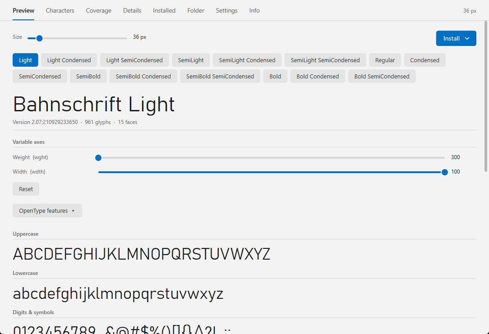
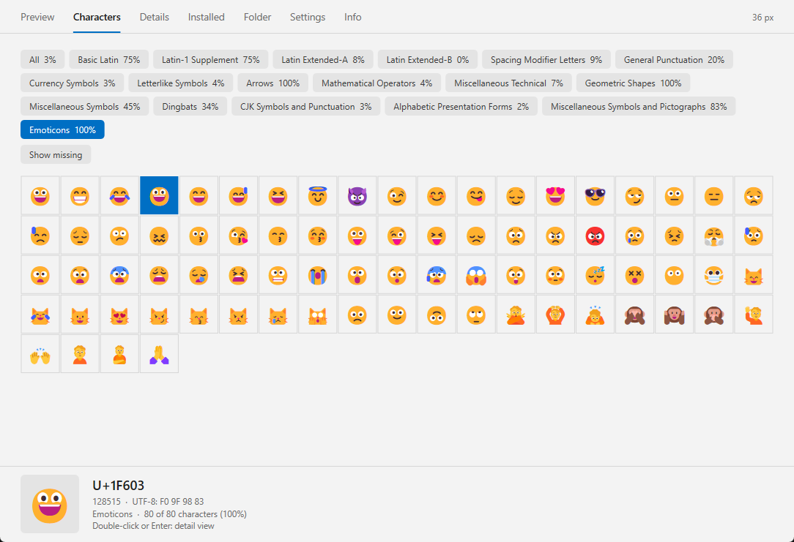

# Fontarium

[English](README.md) | **Deutsch**

Ein Schriftbetrachter (Lister-Plugin) für den [Total Commander](https://www.ghisler.com), 32 und 64 Bit.
F3 auf einer Schriftdatei (TTF, OTF, TTC, WOFF, WOFF2 und Windows-Bitmap-Schriften: FON) – und sie erscheint sofort, gezeichnet mit DirectWrite, sodass Persisch, Arabisch und andere Schriften korrekt dargestellt werden. Variable Schriften bekommen Regler für ihre Achsen, OpenType-Features lassen sich ein- und ausschalten, und ein Glyphen-Inspektor zeigt jedes Zeichen. Nativ, ohne Laufzeitumgebung, außer dem Plugin muss nichts installiert werden.

Fontarium wurde vom Plugin FontMaster inspiriert. Ich habe es geschrieben, weil ich volle Unterstützung für Sprachen mit Schreibrichtung von rechts nach links wie Persisch und Arabisch haben wollte.

## Funktionen

- **Vorschau:** Großbuchstaben, Kleinbuchstaben, Ziffern & Symbole, ein Beispielsatz, eigener Text und Größenstufen; eine Schaltfläche pro Schnitt der Schrift. Ein Regler stellt die Vorschaugröße ein, und ein Knopf *Installieren* installiert die Schrift für den aktuellen Benutzer oder für alle Benutzer
- **Variable Schriften:** ein Regler für jede Achse (Gewicht, Breite, …) mit *Zurücksetzen*
- **OpenType-Features:** aufgeführt werden nur Features, die die Schrift enthält; ein Klick schaltet um: *Standard → an → aus*
- **Eigener Text:** mehrzeilig möglich, jede Zeile wird für sich gesetzt (mit eigener Richtung und Sprache) – so lassen sich z. B. Persisch und Deutsch mischen. Richtung und Sprache lassen sich auch in den Einstellungen festlegen
- **Zeichen:** eine Schaltfläche *Alle* (standardmäßig gewählt) zeigt alle Zeichen der Schrift in einem Raster; darunter alle Unicode-Blöcke der Schrift, Abdeckung (z. B. *120 von 256 Zeichen*), *Fehlende anzeigen* und ein Glyphen-Inspektor, der den Umriss mit seinen Kurven- und Kontrollpunkten zeichnet, dazu die Hilfslinien (Oberlänge, Versalhöhe, x-Höhe, Grundlinie, Unterlänge) und die Glyphenwerte (Glyphen-Nummer, Einheiten pro Em, Vorschub, Seitenabstände, Begrenzungsbox, Konturen und Knoten; die Schaltfläche *Knoten* blendet die Knoten ein oder aus) sowie Einzel-, Anfangs-, Mittel- und Endform. Farbige Zeichen wie Emoji werden farbig gezeichnet. Doppelklick oder Enter öffnet die Detailansicht; Rechtsklick öffnet ein Menü zum Kopieren von Zeichen, Codepoint, Zeichenname, Glyphenname, Glyphen-ID, HTML-Entity, CSS-Escape oder UTF-8-Bytes, zum Kopieren oder Exportieren des Umrisses als SVG oder als PNG-Bild und zum Kopieren einer `@font-face`-Regel. Das Feld *Gehe zu* springt direkt zu einem Zeichen oder Code (`€`, `20AC` oder `U+20AC`)
- **Abdeckung:** welche Schriftsysteme die Schrift setzen kann (Latein, Kyrillisch, Griechisch, Arabisch, Persisch, Hebräisch, Thai, CJK, …) als Balken mit Prozentwerten, dazu die nicht abgedeckten Schriftsysteme
- **Details:** Namen, Rechtliches (Copyright, Designer, Lizenz, mit Links), Technik (Format, Dateigröße, Glyphen, Schnitte in der Datei, variable Achsen, Metriken) und die unterstützten Sprachen; ein Klick auf einen Wert kopiert ihn in die Zwischenablage, per Rechtsklick gibt es *Wert kopieren* und *Name und Wert kopieren*
- **Installiert:** alle auf diesem PC installierten Schriften, mit Vorschau rechts
- **Ordner:** die Schriften aus dem Ordner der geöffneten Datei oder aus einem gewählten Ordner (auf Wunsch mit Unterordnern)
- **Installieren, Deinstallieren, Aktivieren, Deaktivieren** in den Reitern *Installiert* und *Ordner*. *Installieren* bietet *Für aktuellen Benutzer installieren* und *Für alle Benutzer installieren* (Windows fragt einmal nach Administratorrechten, für alle gewählten Schriften). Webfonts (WOFF, WOFF2) lassen sich nicht installieren; Systemschriften lassen sich nur mit Administratorrechten entfernen
- **Bitmap-Schriften (.fon):** Windows-Rasterschriften wie die in `C:\Windows\Fonts` werden Pixel für Pixel angezeigt, mit allen Reitern; eine Datei mit mehreren Größen bekommt eine Schaltfläche je Größe. Vektor-`.fon`-Dateien werden nicht unterstützt; `.fon`-Dateien lassen sich nicht installieren
- **Nächste / vorherige Schrift:** Links / Rechts (oder Bild↑ / Bild↓ am Seitenende) öffnen die vorherige / nächste Schriftdatei des Ordners, wie in einem Bildbetrachter
- Helles und dunkles Design (automatisch wie Windows, fest oder wie Total Commander) im Windows-11-Stil; Kantenglättung ClearType, Graustufen oder aus; farbige Zeichen an oder aus; Größe der Oberfläche von 100 % bis 200 %
- Oberfläche auf Deutsch und Englisch (folgt der Windows-Sprache oder in den Einstellungen wählbar)

## Tasten

| Taste | Aktion |
|---|---|
| Strg+Tab | Nächster Reiter |
| Strg+Bild↑ / Bild↓ | Vorheriger / nächster Schnitt |
| Strg + Mausrad, Strg + + / − | Größe |
| Pfeiltasten, Bild↑ / Bild↓, Pos1 / Ende | Scrollen |
| Links / Rechts (nicht in *Zeichen*), Bild↑ / Bild↓ am Seitenende | Vorherige / nächste Schriftdatei im Ordner |

## Download und Installation

1. **`Fontarium.zip`** vom [neuesten Release](https://github.com/naderi/tc-fontarium/releases/latest) herunterladen.
2. Das ZIP im Total Commander öffnen (Enter auf der Datei) und die Frage nach der Installation des Plugins bestätigen.

Die Einstellungen liegen in `Fontarium.ini` neben dem Plugin (in `%APPDATA%\Fontarium`, wenn dieser Ordner schreibgeschützt ist) und lassen sich im Reiter *Einstellungen* ändern. Um statt mit *Vorschau* mit einem anderen Reiter (z. B. *Zeichen*) zu starten, setze in der ini `starttab=1` (0 Vorschau, 1 Zeichen, 2 Details, 3 Installiert, 4 Ordner, 5 Abdeckung). Um die Knoten in der Glyphenansicht auszublenden, setze `nodes=0` (Standard 1; die Schaltfläche *Knoten* in der Glyphenansicht schaltet es ebenfalls um). Um das Wechseln der Datei mit Links / Rechts abzuschalten, setze `filenav=0` (Standard 1). Benötigt Windows 10 ab Version 1803.

## Lizenz

Freeware – kostenlos nutzbar, aber **nicht zum Verkauf**. Siehe [LICENSE](LICENSE). Fontarium enthält [Brotli](https://github.com/google/brotli) und [woff2](https://github.com/google/woff2) von Google (MIT-Lizenz), um WOFF- und WOFF2-Schriften zu lesen.

## Unterstützung

Wenn Fontarium dir Zeit spart, kannst du die Entwicklung auf Ko‑fi unterstützen. ☕

---

© 2026 [Ali Naderi](https://github.com/naderi) · [digitalent.dev](https://digitalent.dev/de/)
