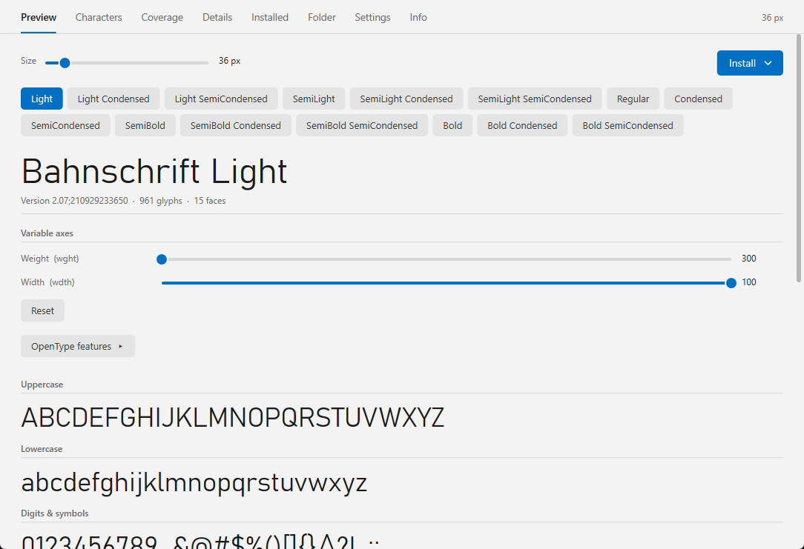
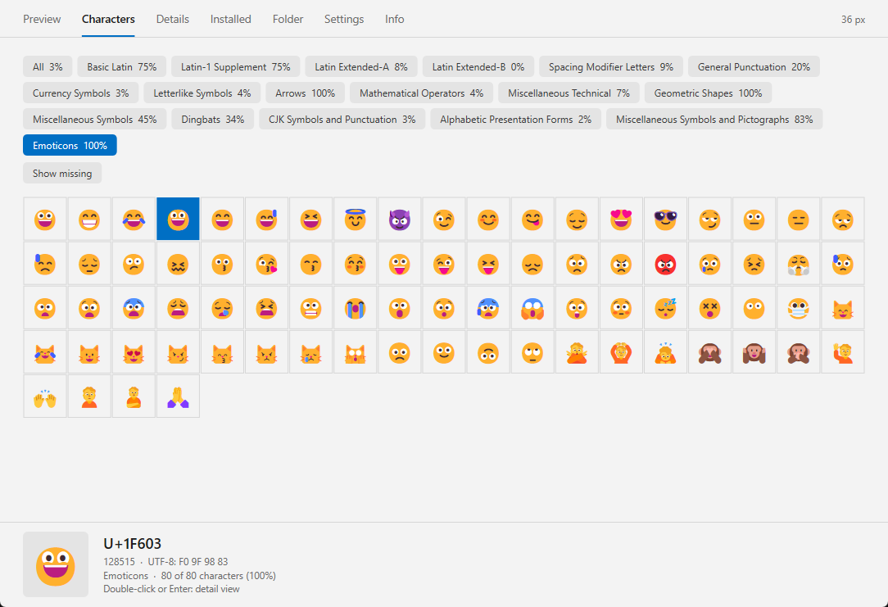

# Fontarium

**English** | [Deutsch](README.de.md)

A font viewer (Lister plugin) for [Total Commander](https://www.ghisler.com), 32 and 64 bit.
Press F3 on a font file (TTF, OTF, TTC, WOFF, WOFF2) and see it right there – drawn with DirectWrite, so Persian, Arabic and other scripts are rendered correctly. Variable fonts get sliders for their axes, OpenType features can be switched on and off, and a glyph inspector shows every character. Native, no runtime, nothing to install besides the plugin.

## Features

- **Preview:** uppercase, lowercase, digits & symbols, a sample sentence, your own text and a size ladder; one button per face of the font
- **Variable fonts:** a slider for every axis (weight, width, …) with *Reset*
- **OpenType features:** only the features the font actually contains are listed; a click cycles *default → on → off*
- **Custom text:** several lines are possible, and every line is set on its own with its own direction and language – so Persian and German can be mixed. Direction and language can also be fixed in the settings
- **Characters:** an *All* button (selected by default) shows every character of the font in one grid; below it all Unicode blocks of the font, coverage (e.g. *120 of 256 characters*), *Show missing*, and a glyph inspector with glyph index, advance width, side bearings, outline size and the isolated / initial / medial / final forms. Color glyphs such as emoji are drawn in color. Double-click or Enter opens the detail view
- **Details:** names, legal information (copyright, designer, license, with links), technical data (format, file size, glyphs, faces in the file, variable axes, metrics) and the languages the font supports; click a value to copy it to the clipboard
- **Installed:** all fonts installed on this PC, with preview on the right
- **Folder:** the fonts in the folder of the opened file, or in a folder you choose (optionally with subfolders)
- **Install, uninstall, activate, deactivate** fonts from the *Installed* and *Folder* tabs. Web fonts (WOFF, WOFF2) cannot be installed; system fonts can only be removed with administrator rights
- Light and dark design (automatic like Windows, fixed, or like Total Commander) in the Windows 11 look; anti-aliasing ClearType, grayscale or off; color glyphs on or off; interface size from 100 % to 200 %
- English and German user interface (follows the Windows language, or choose it in the settings)

## Keys

| Key | Action |
|---|---|
| Ctrl+Tab | Next tab |
| Ctrl+PgUp / PgDn | Previous / next face |
| Ctrl + mouse wheel, Ctrl + + / − | Size |
| Arrow keys, PgUp / PgDn, Home / End | Scroll |

## Download and installation

1. Download **`Fontarium.zip`** from the [latest release](https://github.com/naderi/tc-fontarium/releases/latest).
2. Open the ZIP in Total Commander (Enter on the file) and confirm the question whether to install the plugin.

Settings are stored in `Fontarium.ini` next to the plugin (in `%APPDATA%\Fontarium` if that folder is read-only) and can be changed in the *Settings* tab. To open on another tab (e.g. *Characters*) instead of *Preview*, set `starttab=1` in the ini (0 Preview, 1 Characters, 2 Details, 3 Installed, 4 Folder). Requires Windows 10 version 1803 or newer.

## License

Freeware – free to use, but **not for sale**. See [LICENSE](LICENSE). Fontarium contains [Brotli](https://github.com/google/brotli) and [woff2](https://github.com/google/woff2) by Google (MIT license) to read WOFF and WOFF2 fonts.

## Support

If Fontarium saves you time, you can support its development on Ko‑fi. ☕

---

© 2026 [Ali Naderi](https://github.com/naderi) · [digitalent.dev](https://digitalent.dev/en/)
